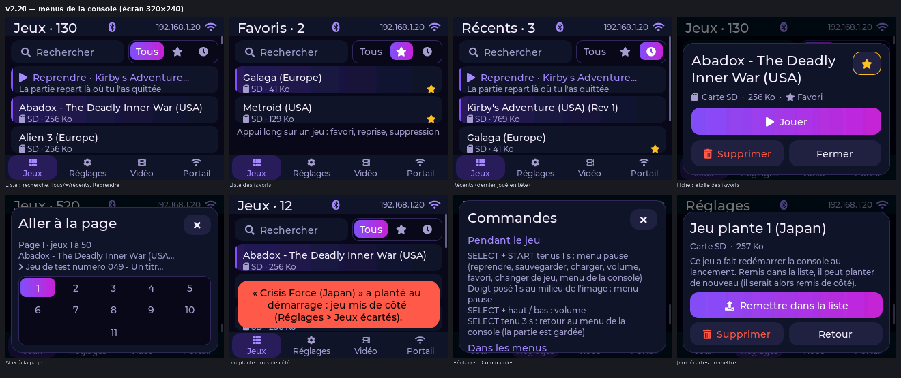
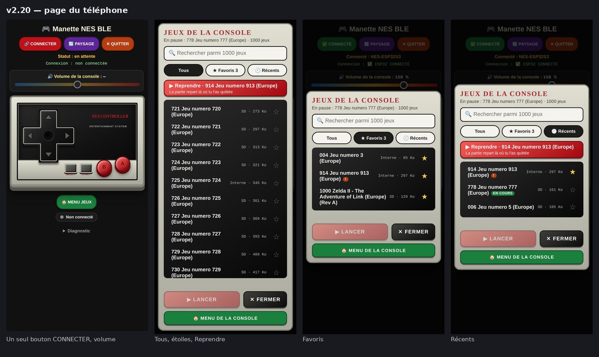
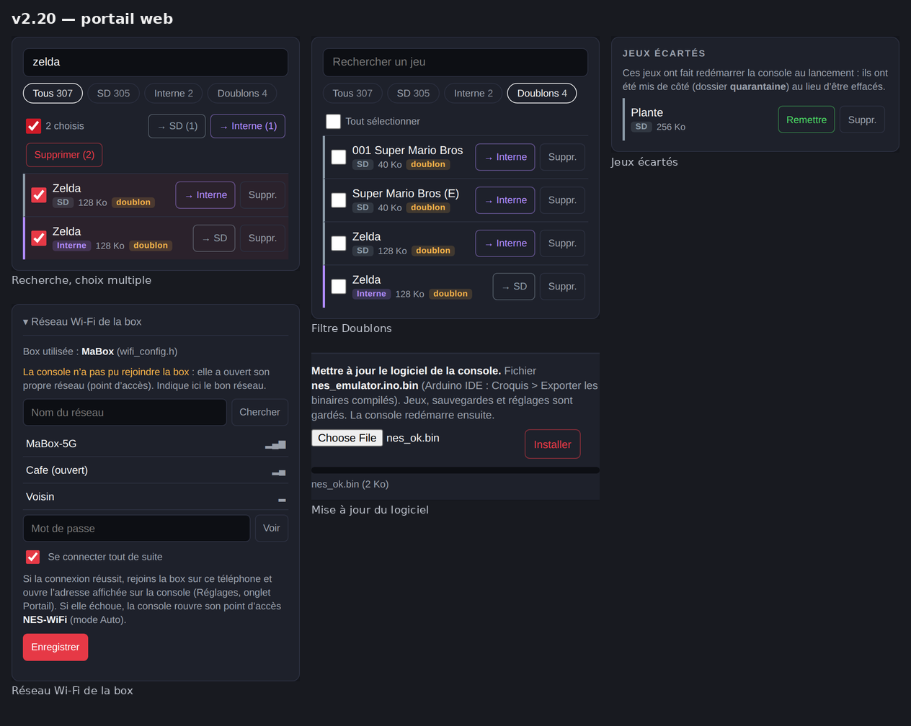
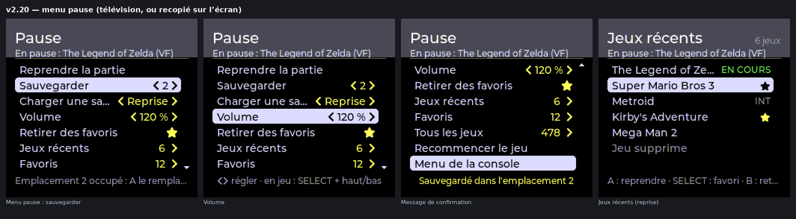

# Console NES ESP32

Une console NES portable construite autour d'un **ESP32-S3** à écran tactile : émulation des jeux NES avec le son, menus modernes, jeux sur carte microSD ou en mémoire interne, sauvegardes, manette NES filaire **ou téléphone Android comme manette Bluetooth**, **sortie télévision** en vidéo composite grâce à un second ESP32, et portail web pour envoyer les jeux et mettre le logiciel à jour par Wi-Fi.



> Projet amateur, en version bêta. Dérivé du dépôt [Esp32-S3-nes-emulator-by-DSN](https://github.com/derdacavga/Esp32-S3-nes-emulator-by-DSN) (derdacavga), lui-même basé sur le cœur d'émulation **nofrendo**. Aucun jeu n'est fourni.

## Sommaire

- [Fonctionnalités](#fonctionnalités)
- [Matériel](#matériel)
- [Contenu du dépôt](#contenu-du-dépôt)
- [Installation](#installation)
- [Premiers pas](#premiers-pas)
- [Manette sur le téléphone](#manette-sur-le-téléphone)
- [Options de compilation](#options-de-compilation)
- [Limites connues](#limites-connues)
- [Crédits et licences](#crédits-et-licences)

## Fonctionnalités

**Jeux**
- Émulation NES (cœur nofrendo) avec le son ; 49 mappers : 0 à 5, 7 à 11, 15, 16, 18, 19, 21 à 25, 32 à 34, 40 à 42, 46, 50, 64 à 66, 69 à 71, 73, 75, 78, 79, 85, 87, 93, 94, 99, 113, 118, 160, 229, 231, 232. Un jeu non pris en charge est refusé avec un message.
- Jeux sur **carte microSD** et en **mémoire interne** (partition FAT de la flash, ~9,6 Mo) ; jusqu'à **1000 jeux**, affichés par pages de 50.
- **Sauvegardes** : RAM de pile des cartouches (Zelda, Final Fantasy…), sauvegarde instantanée sur 3 emplacements, **reprise automatique** en quittant un jeu.
- **Menu pause** en partie : reprendre, sauvegarder, charger, volume, favoris, jeux récents, changer de jeu sans redémarrer.
- Un jeu qui fait planter la console au lancement est **mis de côté** (dossier `/quarantaine`), récupérable ensuite.

**Interface**
- Menus **LVGL 8** sur l'écran tactile 320 × 240 : liste des jeux avec recherche (clavier à l'écran), favoris, récents, « Reprendre » ; Réglages (luminosité, volume, thèmes de couleurs, Wi-Fi, étalonnage du tactile, aide) ; onglets Vidéo et Portail (QR codes).
- Trois manettes, utilisables ensemble : **zones tactiles** de part et d'autre de l'image, **manette NES filaire** (registre CD4021, prise DB9), **téléphone Android** en Bluetooth LE (page web [`manette8.html`](docs/manette/manette8.html)).
- **Plein écran** automatique quand le téléphone sert de manette.

**Télévision**
- **Sortie vidéo composite couleur** PAL 50 Hz, NTSC ou PAL 60 Hz, image progressive au choix, et son, par un second ESP32 relié en SPI (3 fils).
- Liste des jeux et menu pause affichés sur la télévision.

**Wi-Fi**
- Connexion à la box ou **point d'accès** « NES-WiFi » de la console.
- **Portail web** : envoi de jeux (glisser-déposer), déplacement carte SD ↔ mémoire interne, suppression, recherche de doublons, formatage de la carte SD, jeux écartés, réseau Wi-Fi de la box.
- **Mise à jour du logiciel par Wi-Fi** (fichier `.bin` envoyé au portail) : jeux, sauvegardes et réglages sont conservés.

| Page du téléphone | Portail web |
|---|---|
|  |  |



## Matériel

### Carte principale — LCDWIKI ES3C28P

| | |
|---|---|
| Processeur | **ESP32-S3R8** : 2 cœurs Xtensa LX7 à 240 MHz, 512 Ko de SRAM, **8 Mo de PSRAM** octale (OPI) |
| Flash | **16 Mo** |
| Écran | **ILI9341 2,8"**, 320 × 240, SPI |
| Tactile | **FT6336**, capacitif (I2C) |
| Son | codec **ES8311** (I2C + I2S) et amplificateur, haut-parleur |
| Stockage | lecteur **microSD** (SD_MMC) |
| Radio | Wi-Fi 2,4 GHz, Bluetooth LE |

### Carte vidéo — ESP32 « classique » (facultative)

| | |
|---|---|
| Carte | **Freenove ESP32-WROOM** (module ESP32-WROOM-32E) ou ESP32-DevKitC V4 |
| Processeur | ESP32-D0WD-V3 : 2 cœurs Xtensa LX6 à 240 MHz, 520 Ko de SRAM, 4 Mo de flash |
| Vidéo | composite couleur sur **GPIO25** (DAC intégré), vers l'entrée AV d'un téléviseur ou un convertisseur AV → HDMI |
| Son | **GPIO26** en PWM + filtre RC |

Seul l'ESP32 d'origine a le DAC nécessaire à la vidéo : un ESP32-S2, S3 ou C3 ne convient pas pour cette carte.

### Câblage minimal

| ESP32-S3 (ES3C28P) | | Carte vidéo ESP32 |
|---|---|---|
| GPIO2 (connecteur « Expanded IO ») | SCLK, 330 Ω | IO14 |
| GPIO3 (connecteur « Expanded IO ») | CS, 330 Ω | IO15 |
| GPIO43 / TX0 (connecteur « UART ») | MOSI, 330 Ω | IO13 |
| GND | masse | GND |

Manette NES filaire (3,3 V) : LATCH → GPIO21, CLOCK → GPIO14, DATA → GPIO44 (RX0).

Le document [docs/MATERIEL.md](docs/MATERIEL.md) détaille tout : brochage complet, sortie vidéo (pourquoi GPIO25 va directement à la prise RCA), manette, **carte porteuse KiCad** qui réunit les deux cartes (alimentation 9–12 V, prises RCA, DB9), listes d'achat, mise en service et dépannage.

## Contenu du dépôt

```
console-nes-esp32/
├── firmware/
│   ├── nes_emulator/         croquis de la console (ESP32-S3)
│   └── video_coprocessor/    croquis de la carte vidéo TV (ESP32)
├── prototypes/
│   └── autonome_prototype_v0.4/   essai d'émulateur minimaliste sur un seul ESP32
├── config/
│   ├── lv_conf.h             configuration LVGL 8.3 utilisée
│   └── User_Setup.h          configuration TFT_eSPI de l'écran ES3C28P
├── hardware/kicad/           carte porteuse et manette (KiCad, PDF, nomenclatures, import EasyEDA)
├── docs/
│   ├── MATERIEL.md           matériel, câblage, sortie vidéo, carte porteuse
│   ├── protocole_bluetooth.md  manette du téléphone : utilisation et protocole
│   ├── aide_memoire.html     aide-mémoire des commandes (à imprimer)
│   ├── manette/              page web de la manette du téléphone
│   └── images/
├── CHANGELOG.md
└── LICENSE
```

## Installation

### 1. Outils

- **IDE Arduino 2.x** et le paquet de cartes **esp32 d'Espressif Systems, version 3.x** (compilé avec la 3.3.11).
- Bibliothèques (Gestionnaire de bibliothèques ou copie manuelle dans `Arduino/libraries/`) :

| Bibliothèque | Version | Pour | Configuration |
|---|---|---|---|
| **lvgl** | **8.3.11** (pas la 9.x) | console | copier [`config/lv_conf.h`](config/lv_conf.h) dans `Arduino/libraries/`, à côté du dossier `lvgl` |
| **TFT_eSPI** | 2.5.43 | console | remplacer `Arduino/libraries/TFT_eSPI/User_Setup.h` par [`config/User_Setup.h`](config/User_Setup.h) |
| **LovyanGFX** | 1.2.x | carte vidéo | aucune |

Wi-Fi, Bluetooth, serveur web, mise à jour OTA, NVS, SD_MMC et FFat sont fournis par le paquet esp32.

### 2. Identifiants Wi-Fi

Dans `firmware/nes_emulator/`, copier `wifi_config.example.h` en **`wifi_config.h`** et y mettre le nom et le mot de passe de la box ; changer aussi le mot de passe du point d'accès `NES-WiFi` (8 caractères au moins). `wifi_config.h` est ignoré par git : il ne part pas sur le dépôt. Sans lui, le croquis compile avec le modèle (le point d'accès reste utilisable, et le réseau de la box peut être saisi plus tard dans le portail).

### 3. Console (ESP32-S3)

Ouvrir `firmware/nes_emulator/nes_emulator.ino`, puis dans le menu **Outils** :

| Réglage | Valeur |
|---|---|
| Carte | **ESP32S3 Dev Module** |
| USB CDC On Boot | **Enabled** (le port série passe par l'USB ; GPIO43/44 restent libres pour la liaison vidéo et la manette) |
| Flash Size | **16MB (128Mb)** |
| Partition Scheme | **16M Flash (3MB APP/9.9MB FATFS)** |
| PSRAM | **OPI PSRAM** |

Téléverser. Si le téléversement échoue : maintenir BOOT, appuyer sur RESET, relâcher BOOT.

Avec arduino-cli :

```sh
arduino-cli compile -b "esp32:esp32:esp32s3:PSRAM=opi,FlashSize=16M,CDCOnBoot=cdc,PartitionScheme=app3M_fat9M_16MB" firmware/nes_emulator
```

**Sans carte vidéo**, mettre `ENABLE_VIDEO_LINK` à 0 dans `video_link.h`.

### 4. Carte vidéo (ESP32)

Ouvrir `firmware/video_coprocessor/video_coprocessor.ino`, carte **ESP32 Dev Module**, bibliothèque LovyanGFX, téléverser. Sans console branchée, la télévision affiche « En attente de la console » avec une mire de couleurs ; un appui long sur BOOT change la norme (PAL 50 → NTSC → PAL 60).

```sh
arduino-cli compile -b esp32:esp32:esp32 firmware/video_coprocessor
```

## Premiers pas

1. **Jeux** : copier des fichiers `.nes` à la **racine** d'une carte microSD formatée en **FAT32**, ou les envoyer plus tard par le portail (carte SD ou mémoire interne).
2. **Premier démarrage** : l'écran demande d'étalonner le tactile (toucher 3 croix, puis une croix de vérification).
3. **Jouer** : toucher un jeu. Un appui long ouvre sa fiche (favori, reprendre, supprimer).

| Commande | Pendant le jeu |
|---|---|
| SELECT + START tenus 1 s | menu pause (écran ou télévision) |
| doigt posé 1 s sur l'image | menu pause (écran tactile) |
| SELECT + haut / bas | volume ±5 % |
| SELECT tenu 3 s | retour au menu de la console (la partie est gardée) |

Toutes les commandes sont dans Réglages (aide « Commandes ») et dans l'[aide-mémoire](docs/aide_memoire.html) à imprimer.

### Portail web

1. Réglages > Wi-Fi : allumer le Wi-Fi (mode Auto : la box, puis le point d'accès si elle ne répond pas).
2. L'onglet **Portail** affiche l'adresse et un QR code. En point d'accès : rejoindre le réseau **`NES-WiFi`** (mot de passe défini dans `wifi_config.h`), puis ouvrir **http://192.168.4.1/**.

Le Wi-Fi est coupé au lancement d'un jeu, et il ne fonctionne pas en même temps que la manette Bluetooth (mémoire de l'ESP32-S3 insuffisante pour les deux).

### Mise à jour du logiciel par Wi-Fi

Dans l'IDE Arduino : **Croquis > Exporter les binaires compilés**, puis envoyer le fichier `nes_emulator.ino.bin` dans la section « Mettre à jour le logiciel » du portail. La console redémarre sur la nouvelle version ; jeux, sauvegardes et réglages sont conservés.

> Les fichiers `.bin` compilés contiennent les identifiants Wi-Fi de `wifi_config.h` : ne pas les publier (ils sont ignorés par git).

## Manette sur le téléphone

La page [`docs/manette/manette8.html`](docs/manette/manette8.html) utilise **Web Bluetooth**, qui exige **Chrome sur Android** et une page servie en **HTTPS**. GitHub Pages s'en charge :

1. Sur GitHub, dépôt > **Settings > Pages** ; *Source* : **Deploy from a branch**, branche **main**, dossier **/docs**, *Save*.
2. Quelques minutes plus tard, la page est disponible à l'adresse
   `https://<pseudo>.github.io/console-nes-esp32/manette/manette8.html`.
3. L'ouvrir dans Chrome sur le téléphone (Bluetooth et localisation activés), **CONNECTER**, choisir **`NES-ESP32S3`**. Chrome > ⋮ > « Ajouter à l'écran d'accueil » l'installe comme une application.

Utilisation et protocole : [docs/protocole_bluetooth.md](docs/protocole_bluetooth.md).

## Options de compilation

| Fichier | Option | Défaut | Rôle |
|---|---|---|---|
| `hw_config.h` | `HAS_PHYSICAL_CONTROLLER` | 0 | 1 = manette filaire branchée |
| `hw_config.h` | `PAD_PROTOCOL` | `PAD_PROTOCOL_NES` | manette NES (CD4021) ou montage 74HC165 |
| `hw_config.h` | `USE_TOUCH_CONTROLS` | 1 | zones tactiles pendant le jeu |
| `hw_config.h` | `ENABLE_BLE_GAMEPAD` | 1 | manette du téléphone (0 : pile Bluetooth non compilée, ~230 Ko de moins) |
| `hw_config.h` | `LCD_FULLSCREEN_MODE` | 1 | plein écran : 0 jamais, 1 avec le téléphone, 2 toujours |
| `hw_config.h` | `LCD_FULLSCREEN_CROP_LINES` | 8 | lignes retirées en haut et en bas en plein écran |
| `hw_config.h` | `LCD_GAME_COLOR_FIX` | 1 | ordre des octets des couleurs du jeu sur l'écran |
| `hw_config.h` | `USE_LVGL_UI` | 1 | 0 = ancienne interface dessinée à la main |
| `video_link.h` | `ENABLE_VIDEO_LINK` | 1 | liaison vers la carte vidéo (0 sans carte vidéo) |
| `wifi_boot.h` | `ENABLE_WIFI_PORTAL` | 1 | Wi-Fi et portail web |
| `wifi_boot.h` | `WIFI_START_AT_BOOT` | 0 | 1 = connexion Wi-Fi pendant le logo |
| `video_coprocessor.ino` | `VIDEO_OUTPUT_LEVEL` | 128 | amplitude vidéo : 160–200 si l'image est sombre, 100–110 si elle est trop claire |

## Limites connues

- Logiciel en **version bêta**. Selon les jeux, l'émulateur saute des images pour garder la vitesse du jeu.
- Wi-Fi et Bluetooth ne fonctionnent pas en même temps (le Bluetooth est arrêté tant que le Wi-Fi est allumé).
- Web Bluetooth : Chrome sur Android uniquement (Safari sur iPhone ne le propose pas).
- La **carte porteuse KiCad** est placée mais **pas routée**, et n'a pas été fabriquée.
- Le prototype « autonome » (un seul ESP32) valide le matériel mais n'exécute pas encore de jeu.

## Crédits et licences

- Ce projet est distribué sous licence **GNU GPL v3** ([LICENSE](LICENSE)), comme le dépôt d'origine [derdacavga/Esp32-S3-nes-emulator-by-DSN](https://github.com/derdacavga/Esp32-S3-nes-emulator-by-DSN).
- Cœur d'émulation **nofrendo** © 1998-2000 Matthew Conte, repris via [esp32-nesemu](https://github.com/espressif/esp32-nesemu) d'Espressif : licence GNU LGPL v2 ([LICENSES/LGPL-2.0.txt](LICENSES/LGPL-2.0.txt)), mention de licence d'origine au début de chaque fichier repris.
- Pilote du codec **ES8311** : Espressif Systems, licence Apache-2.0 (en-têtes SPDX conservés, [LICENSES/Apache-2.0.txt](LICENSES/Apache-2.0.txt)).
- Générateur de **QR code** : Project Nayuki, licence MIT (texte dans `nes_qrcodegen.c/.h`).
- Sortie vidéo composite : adaptation de `Panel_CVBS` de [LovyanGFX](https://github.com/lovyan03/LovyanGFX) (lovyan03 et contributeurs), licence FreeBSD (`firmware/video_coprocessor/LICENCE_LovyanGFX.txt`) ; inspirée de [ESP_8_BIT_composite](https://github.com/Roger-random/ESP_8_BIT_composite) (Roger Cheng) et [esp_8_bit](https://github.com/rossumur/esp_8_bit) (rossum).
- Polices de l'interface : **Montserrat** (SIL Open Font License 1.1) et symboles **Font Awesome Free** (SIL OFL 1.1 / CC BY 4.0), converties par lv_font_conv. Polices de la carte vidéo : Adobe Helvetica (polices X11), extraites de [U8g2](https://github.com/olikraus/u8g2).
- Bibliothèques : [LVGL](https://lvgl.io) (MIT, `config/lv_conf.h` dérivé de son modèle), [TFT_eSPI](https://github.com/Bodmer/TFT_eSPI) (Bodmer).
- Détail fichier par fichier : [NOTICE](NOTICE) ; textes des licences : dossier [LICENSES](LICENSES).

## Avertissement

NES et Nintendo sont des marques de Nintendo. Ce projet n'est ni affilié à Nintendo ni approuvé par Nintendo. **Aucun jeu n'est fourni** : n'utilisez que des jeux dont vous avez le droit de vous servir (jeux libres « homebrew », copies de vos propres cartouches selon la loi de votre pays).
