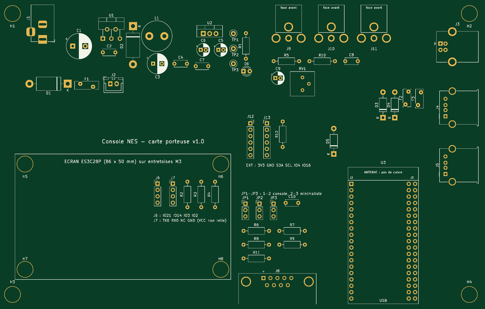
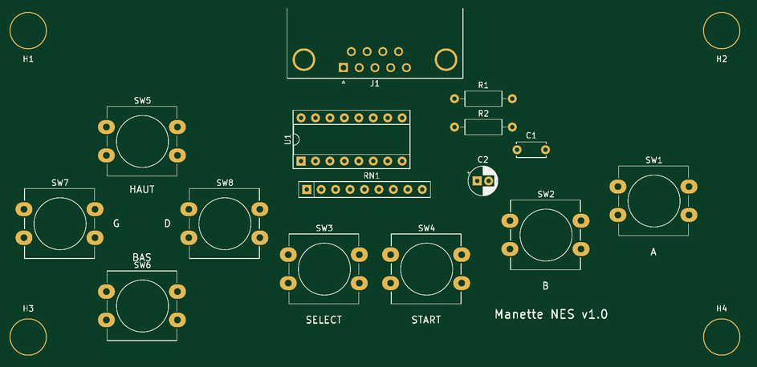

# Matériel

Ce document décrit le matériel de la console : les deux cartes ESP32, leur câblage, la sortie télévision, la manette filaire et la **carte porteuse KiCad** qui peut tout réunir.

> **État de la carte porteuse** : les deux projets KiCad (carte porteuse et manette) sont complets côté schéma (ERC 0 erreur) et les composants sont placés, mais **les pistes restent à router**. Ils n'ont pas encore été fabriqués. La console elle-même peut être câblée à la main sans cette carte (voir « Câblage »).



## Vue d'ensemble

```
 Carte principale ES3C28P (ESP32-S3)              Carte vidéo (ESP32 classique)
 émulateur, menus, écran, tactile, son,           vidéo composite et son pour la TV
 microSD, Wi-Fi, Bluetooth
        GPIO2  (SCLK) ─────── 330 Ω ──────────────► IO14
        GPIO3  (CS)   ─────── 330 Ω ──────────────► IO15
        GPIO43 (MOSI) ─────── 330 Ω ──────────────► IO13
        GND ──────────────────────────────────────── GND
                                                     GPIO25 ──► RCA jaune (vidéo)
        GPIO21 (LATCH) ──► manette NES (DB9)         GPIO26 ──► filtre ──► RCA blanche / rouge
        GPIO14 (CLOCK) ──►
        GPIO44 (DATA)  ◄──                           TV, ou convertisseur AV → HDMI
        Bluetooth LE ◄──► téléphone Android (manette8.html)
```

L'ESP32-S3 fait tourner l'émulateur et envoie l'image (bandes de 15 lignes, compressées, avec somme de contrôle) et le son à l'ESP32 « classique », qui fabrique le signal vidéo composite couleur et le son pour la télévision. Le téléphone se connecte en Bluetooth à l'ESP32-S3 ; ses boutons s'ajoutent à ceux de la manette filaire et du tactile.

## Carte principale : LCDWIKI ES3C28P

| | |
|---|---|
| Processeur | ESP32-S3R8 : 2 cœurs Xtensa LX7 à 240 MHz, 512 Ko de SRAM, 8 Mo de PSRAM octale (OPI) |
| Mémoire flash | 16 Mo (3 Mo de programme × 2 pour la mise à jour OTA, ~9,9 Mo de partition FAT pour les jeux) |
| Écran | ILI9341 2,8" 320 × 240, SPI |
| Tactile | FT6336, capacitif, I2C |
| Son | codec ES8311 (I2C + I2S) et amplificateur, haut-parleur 8 Ω |
| Stockage | lecteur microSD (SD_MMC, utilisé en mode 1 bit) |
| Radio | Wi-Fi 2,4 GHz et Bluetooth LE |
| Connecteurs utilisés | USB-C (alimentation, programmation), « Expanded IO » (IO21, IO14, IO3, IO2), « UART » (TX0 = GPIO43, RX0 = GPIO44) |

Brochage utilisé par le programme (`firmware/nes_emulator/hw_config.h`) :

| Fonction | GPIO |
|---|---|
| Écran SPI (TFT_eSPI) | MOSI 11, SCLK 12, MISO 13, CS 10, DC 46, rétroéclairage 45 (PWM) |
| I2C (codec, tactile) | SDA 16, SCL 15 ; reset du tactile 18 |
| I2S (codec) | BCK 5, WS 7, DO 8, MCLK 4 |
| Amplificateur | 1 (actif à l'état bas) |
| microSD | CLK 38, CMD 40, D0 39 (D1 41, D2 48, D3 47) |
| Manette filaire | LATCH 21, CLOCK 14, DATA 44 |
| Liaison carte vidéo | SCLK 2, CS 3, MOSI 43 |

Les six broches libres de la carte (connecteurs « Expanded IO » et « UART ») sont toutes utilisées : trois pour la manette, trois pour la liaison vidéo. GPIO43 et GPIO44 ne sont libres que si l'option **« USB CDC On Boot : Enabled »** est choisie dans l'IDE Arduino (le port série passe alors par l'USB).

## Carte vidéo : ESP32 « classique »

Le signal vidéo est fabriqué par le **DAC intégré** de l'ESP32 d'origine (GPIO25), que les ESP32-S2/S3/C3/C6 n'ont pas. Carte utilisée : **Freenove ESP32-WROOM** (module ESP32-WROOM-32E) ; une **ESP32-DevKitC V4** (38 broches) convient aussi, c'est elle que vise la carte porteuse.

| | |
|---|---|
| Module | ESP32-WROOM-32E (puce ESP32-D0WD-V3) : 2 cœurs Xtensa LX6 à 240 MHz, 520 Ko de SRAM, 4 Mo de flash |
| Vidéo | composite couleur PAL 50 Hz, NTSC 60 Hz ou PAL 60 Hz sur **GPIO25** (DAC), image 256 × 240, progressive ou entrelacée |
| Son | **GPIO26** en PWM, filtré par R 1 kΩ / C 10 nF, 16 kHz mono |
| Liaison | SPI esclave : IO14 = SCLK, IO15 = CS, IO13 = MOSI (10 MHz au plus : l'esclave SPI de l'ESP32 n'est garanti que sous 11,4 MHz) |
| Bouton BOOT | appui long, console débranchée : change la norme (PAL 50 → NTSC → PAL 60) |

À éviter : ESP32-S2, S3, C3, C6, H2 (pas de DAC vidéo), cartes 30 broches (autre brochage), modules WROVER (la PSRAM prend GPIO16 et 17).

## Câblage

### Liaison entre les deux cartes

| Signal | ESP32-S3 (ES3C28P) | Résistance série conseillée | ESP32 (carte vidéo) |
|---|---|---|---|
| SCLK | GPIO2 (« Expanded IO ») | 330 Ω | IO14 |
| CS | GPIO3 (« Expanded IO ») | 330 Ω | IO15 |
| MOSI | GPIO43 / TX0 (« UART ») | 330 Ω | IO13 |
| Masse | GND | — | GND |

Les résistances de 330 Ω limitent le courant si une seule des deux cartes est alimentée. Liaison à sens unique : rien ne revient vers l'ESP32-S3.

> La documentation LCDWIKI ne donne pas l'ordre physique des broches du connecteur « UART » : repérer TX, RX, VCC et GND sur la sérigraphie et confirmer au multimètre avant de brancher. Le fil VCC reste isolé.

### Sortie télévision

- **Vidéo** : GPIO25 va **directement** à la prise RCA jaune, sans résistance ni condensateur. L'entrée vidéo de la télévision ou du convertisseur AV → HDMI est déjà chargée par 75 Ω, et le programme règle les niveaux du DAC pour ce branchement (environ 1 V crête à crête sur 75 Ω : 0,3 V de synchro + 0,7 V d'image). Une résistance série de 75 Ω diviserait le signal par deux (image sombre) ; un condensateur de liaison déformerait les tops de synchronisation.
- **Son** : GPIO26 → R 1 kΩ / C 10 nF (coupure vers 16 kHz) → C 10 µF → potentiomètre 10 kΩ (niveau) → prises RCA blanche et rouge (même son sur les deux).
- Image trop sombre ou qui décroche : `VIDEO_OUTPUT_LEVEL` à 160–200 dans `video_coprocessor.ino` ; blancs « brûlés » : 100–110.
- Choisir un convertisseur AV → HDMI qui accepte PAL et NTSC ; brancher et débrancher les câbles console éteinte.

### Manette NES filaire

Registre **CD4021BE** câblé comme dans la manette NES d'origine (A sur D7 … Droite sur D0), alimenté en **3,3 V** par la console — ne jamais lui envoyer 5 V.

| DB9 | Signal | ESP32-S3 |
|---|---|---|
| 2 | DATA (sortie Q7 du 4021, 0 = appuyé) | GPIO44 |
| 3 | LATCH (impulsion haute de 12 µs) | GPIO21 |
| 4 | CLOCK (front montant = bouton suivant, ~80 kHz) | GPIO14 |
| 6 | +3,3 V (par 100 Ω) | — |
| 8 | GND (boîtier aussi) | GND |

Côté console : 1 kΩ en série sur chaque signal, 47 kΩ de rappel au +3,3 V sur DATA (sans manette, aucun bouton n'est vu appuyé). Une vraie manette NES alimentée en 3,3 V par un adaptateur fonctionne aussi. Dans `hw_config.h` : `HAS_PHYSICAL_CONTROLLER 1` et `PAD_PROTOCOL PAD_PROTOCOL_NES` (défaut). Un montage à 8 boutons sur un **74HC165** reste possible (`PAD_PROTOCOL_HC165`).

## Carte porteuse KiCad

Dossier `hardware/kicad/console_nes/` (schéma A3, PCB placé, bibliothèques du projet, PDF, nomenclature CSV, rapports ERC/DRC).

- **190 × 120 mm**, 2 couches, 55 composants, **tout en traversant** ; la carte écran ES3C28P est vissée sur 4 entretoises M3 de 15 mm, l'ESP32-DevKitC s'enfiche sur deux barrettes femelles 1 × 19 (deux écartements possibles : 25,4 mm pour la DevKitC officielle, 22,86 mm pour beaucoup de clones).
- **Alimentation** : bloc secteur régulé 9–12 V (jack 5,5 × 2,1 mm, centre +), diode anti-inversion 1N5822, fusible réarmable 2 A, interrupteur ; **LM2596T-5.0** → +5 V / 3 A (schéma type TI : 470 µF, 1N5822, 33 µH, 220 µF faible ESR) ; **LM1117T-3.3** → +3,3 V (manette, rappels, extension) ; LED et points de test.
- **USB** : USB-B (J3) vers le PC, relayé vers l'USB-C de l'écran par un câble court (J4) ; diodes 1N5819 pour choisir le 5 V du PC ou celui de la carte ; USB-A (J5, fusible 0,5 A) pour alimenter un convertisseur AV → HDMI.
- **Cavaliers JP1–JP3** : en **1-2**, console complète (l'ESP32-S3 lit la manette) ; en **2-3**, émulateur minimaliste (l'ESP32 seul lit la manette sur IO32, IO33, IO27, et une carte microSD en SPI sur J12 : IO18, IO19, IO23, IO5).
- **Sorties** : prises RCA jaune, blanche et rouge ; prise DB9 mâle de la manette ; extension J13 (3,3 V, GND, IO21 SDA, IO22 SCL, IO4, IO16).
- Les deux ESP32 se reprogramment sans rien démonter.

Règles de routage conseillées : VIN, +5 V et GND en 1,5 mm (3 A), +3,3 V en 0,8 mm, signaux en 0,3 mm ; boucle du LM2596 (C1, D2, L1, C3) au plus court ; plan de masse sur les deux faces sauf sous l'antenne de la DevKit (zone interdite déjà posée) ; composants de moins de 10 mm sous l'écran.

### Manette

Dossier `hardware/kicad/manette_nes/` : **130 × 62 mm**, 15 composants traversants — CD4021BE sur support DIP-16, 8 boutons 12 × 12 mm avec réseau de rappel 8 × 10 kΩ, 100 kΩ qui tiennent LATCH et CLOCK à 0 au repos, prise DB9 femelle. Liaison par une rallonge DB9 mâle–femelle « droite » (fils 1 à 1). Ne jamais brancher sur la prise une manette Atari ou Sega ni un port série de PC.



### Importer dans EasyEDA

Les fichiers sont au format KiCad 6 (ouverts dans KiCad 7, 8 et 9). Pour EasyEDA Pro : Importer → KiCad, avec `hardware/kicad/easyeda/console_nes_kicad_pour_easyeda.zip` (même chose pour la manette). Si l'import échoue : ouvrir le projet dans KiCad, Fichier › Archiver le projet, puis importer ce zip. Vérifier les empreintes avec les pièces achetées (prises RCA, bobine L1, DB9, module microSD) avant de router.

## Listes d'achat

Les nomenclatures complètes (repères, valeurs, pièces conseillées) sont dans `hardware/kicad/*/documents/nomenclature_*.csv`. En plus des composants des deux cartes :

| Qté | Article | Remarque |
|---|---|---|
| 1 | Carte LCDWIKI ES3C28P | carte principale |
| 1 | ESP32-DevKitC V4 ou Freenove ESP32-WROOM (ESP32-WROOM-32E) | carte vidéo |
| 1 | Bloc secteur régulé 12 V 2 A (ou 9 V 2 A), fiche 5,5 × 2,1 mm centre + | 16 V au maximum |
| 1 | Câble court USB-A mâle → USB-C mâle | carte porteuse → écran |
| 2 | Câbles 4 broches au pas de 1,25 mm (MX1.25), fils à connecteur femelle 2,54 mm à l'autre bout | connecteurs « Expanded IO » et « UART » |
| 1 | Rallonge DB9 mâle–femelle droite | console ↔ manette |
| 1 | Câble RCA vidéo 75 Ω + câble audio, 1,5 m au plus | vers la TV ou le convertisseur |
| 1 | Convertisseur AV → HDMI (PAL et NTSC, alimentation USB 5 V) | si la TV n'a pas d'entrée AV |
| 1 | Carte microSD (FAT32) | jeux |
| 1 | Téléphone Android avec Chrome | facultatif : manette Bluetooth |

## Mise en service

1. **Carte nue** (sans modules) : la LED s'allume, TP1 donne 5,0 V (4,8 à 5,2 V), TP2 3,3 V.
2. **Carte vidéo seule** : la programmer avec `video_coprocessor.ino`, la brancher à la TV : écran « En attente de la console » avec une mire de couleurs, deux bips. Régler le niveau du son.
3. **Carte principale** : vérifier les câbles « Expanded IO » et « UART » au multimètre, cavaliers en 1-2, téléverser `nes_emulator.ino` (« USB CDC On Boot : Enabled »).
4. **Manette** : `HAS_PHYSICAL_CONTROLLER 1` dans `hw_config.h` ; les menus répondent aux boutons. Onglet Vidéo : Téléviseur, norme PAL ; la TV affiche « Console connectée », puis le jeu.
5. **Téléphone** : ouvrir `manette8.html` dans Chrome, CONNECTER, choisir `NES-ESP32S3`.

## Dépannage

| Symptôme | À vérifier |
|---|---|
| TV noire ou image qui décroche | norme (appui long sur BOOT de la carte vidéo, ou onglet Vidéo de la console) ; entrée AV ; `VIDEO_OUTPUT_LEVEL` ; aucune résistance ni condensateur en série sur GPIO25 |
| « En attente de la console » alors que le jeu tourne | `ENABLE_VIDEO_LINK 1`, « USB CDC On Boot » activé, câbles de la liaison et masse commune, même version de protocole des deux côtés |
| Pas de son sur la TV | potentiomètre de niveau, sens du condensateur de liaison, deux bips au démarrage de la carte vidéo |
| Manette sans effet | `HAS_PHYSICAL_CONTROLLER 1`, cavaliers, rallonge DB9 droite (1 à 1), 3,3 V sur la broche 6 |
| Boutons mélangés | ordre des boutons sur le 4021 ; `PAD_PROTOCOL_NES` |
| Le téléphone ne trouve pas `NES-ESP32S3` | Chrome sur Android, Bluetooth et localisation activés, page en HTTPS ; Wi-Fi de la console coupé (icône Bluetooth orange = le Bluetooth attend la coupure du Wi-Fi) |
| Réseau NES-WiFi visible mais `http://192.168.4.1/` ne s'ouvre pas | mot de passe du point d'accès ; sur Android, couper les données mobiles ; lignes `[WIFI]` et `[PORTAIL]` du moniteur série |
| Couleurs des jeux fausses sur l'écran (ciel vert) | `LCD_GAME_COLOR_FIX` dans `hw_config.h` |
| Zones tactiles sans effet en partie | téléphone connecté : plein écran, seul le coin bas-droit (SELECT) répond |

## Sources

- Texas Instruments : fiches LM2596, LM1117, CD4021B
- Espressif : guide de l'ESP32-DevKitC V4, fiche ESP32 (DAC sur GPIO25/26), « SPI Slave Driver » d'ESP-IDF
- LCDWIKI : spécification ES3C28P
- LovyanGFX : Panel_CVBS (niveaux de la sortie composite)
- ESP_8_BIT (Roger Cheng) et esp_8_bit (rossum) : vidéo composite sur ESP32
